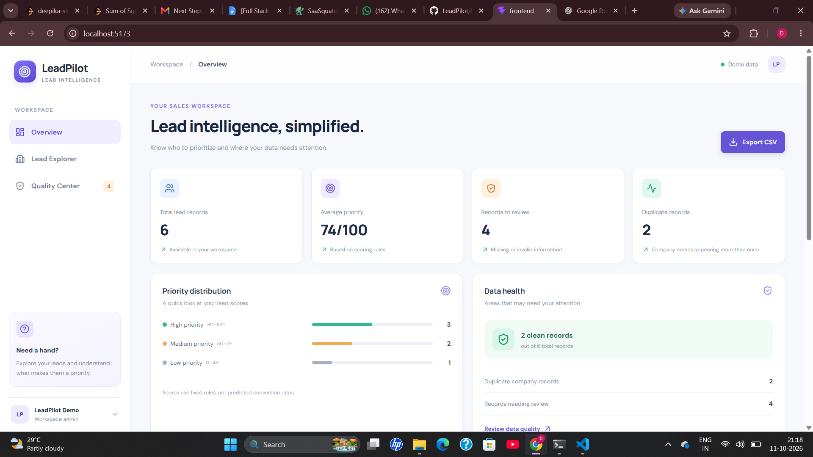
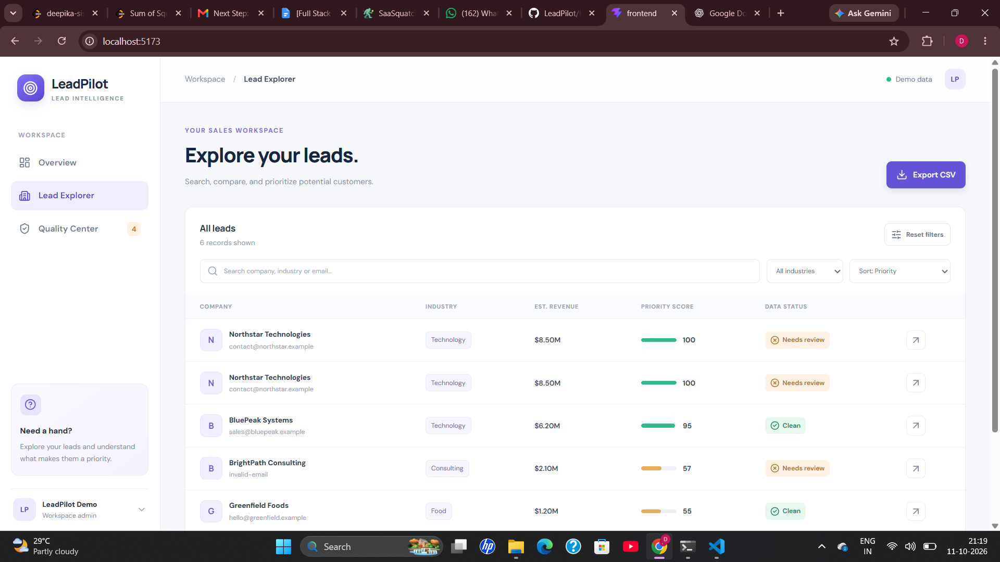
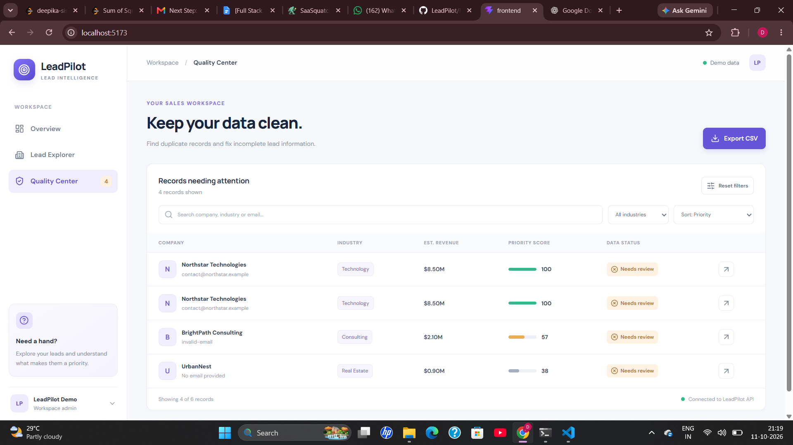

# LeadPilot 🚀
### Lead Prioritization and Data Quality Dashboard

LeadPilot is a full-stack web application designed to help users prioritize business leads and identify data quality issues. It assigns explainable priority scores based on company information and highlights duplicate records and incomplete contact details through a clean, interactive dashboard.

## ✨ Features

- **Lead Scoring:** Calculates lead priority scores using industry, estimated revenue, employee count, email, and website information.
- **Explainable Scoring:** Displays a score breakdown so users can understand how each factor contributes to a lead's priority.
- **Lead Explorer:** Browse, search, filter, and sort leads based on relevant information and priority scores.
- **Data Quality Checks:** Identifies duplicate company names, missing or invalid email addresses, and missing websites.
- **Quality Center:** Provides a focused view of records that need attention.
- **Dashboard Overview:** Displays key metrics, priority distribution, duplicate records, and data health.
- **CSV Export:** Export lead records for further analysis.

## 📸 Screenshots

### Dashboard Overview

A summary of lead records, average priority score, records needing review, and duplicate records.



### Lead Explorer

Search, filter, sort, and compare leads using their company details, priority scores, and data status.



### Quality Center

Identify duplicate records and incomplete or invalid lead information that needs attention.



## 🛠️ Tech Stack

**Frontend**
- React
- JavaScript
- CSS

**Backend**
- Node.js
- Express.js
- REST API

**Data Storage**
- JSON-based sample lead data

**Tools**
- Git and GitHub
- Visual Studio Code

## 📂 Project Structure

```text
LeadPilot/
├── backend/
│   ├── data/
│   │   └── leads.json
│   └── server.js
├── frontend/
│   └── src/
│       ├── App.jsx
│       ├── App.css
│       └── index.css
├── screenshots/
│   ├── overview.png
│   ├── lead-explorer.png
│   └── quality-center.png
└── README.md
```

## ⚙️ Getting Started

### Prerequisites

- Node.js and npm
- Git
- A code editor such as VS Code

### 1. Clone the repository

```bash
git clone YOUR_GITHUB_REPOSITORY_URL
cd LeadPilot
```

Replace `YOUR_GITHUB_REPOSITORY_URL` with your actual GitHub repository URL.

If you already have the project locally, open the existing `LeadPilot` folder in VS Code instead.

### 2. Start the backend

Open a terminal in VS Code and run:

```bash
cd backend
npm install
node server.js
```

The backend runs at:

`http://localhost:5000`

### 3. Start the frontend

Open a **second terminal** in VS Code and run:

```bash
cd frontend
npm install
npm run dev
```

Open the local URL printed by Vite in your terminal, usually:

`http://localhost:5173`

Keep both terminals running while using the application.

> If the project does not contain a `package.json` in either folder, follow the existing project setup rather than running `npm install` blindly.

## 🔌 API Endpoints

| Method | Endpoint | Description |
|---|---|---|
| GET | `/` | Backend welcome response |
| GET | `/api/health` | Check backend health |
| GET | `/api/leads` | Retrieve lead records |
| GET | `/api/leads/score` | Retrieve lead scores and scoring details |
| GET | `/api/leads/quality` | Retrieve lead data quality information |

## 🧮 Lead Scoring Logic

LeadPilot uses a rule-based scoring system with a maximum score of **100 points**.

| Factor | Maximum Points |
|---|---:|
| Industry | 30 |
| Estimated Revenue | 30 |
| Employee Count | 20 |
| Email Availability and Validity | 10 |
| Website Availability | 10 |
| **Total** | **100** |

The score is calculated using predefined rules rather than a machine learning model. The breakdown helps users understand why a lead receives a particular priority score.

## 🧹 Data Quality Checks

The application checks lead records for:
- Duplicate company names
- Missing or invalid email addresses
- Missing website information

These checks help users identify records that may need correction before further use.

## 📌 Current Scope

LeadPilot currently uses sample lead data stored in a JSON file. It is intended as a demonstration of lead prioritization, explainable scoring, and data quality management. Sample contact details should not be treated as verified business contacts.

## 🚀 Future Improvements

- Integrate a database for persistent storage
- Add configurable scoring rules and weights
- Integrate external CRM systems
- Introduce authentication and role-based access
- Add automated testing and more comprehensive data validation

## 👩‍💻 About

LeadPilot is a full-stack project focused on making lead management more organized, transparent, and actionable through explainable scoring and data quality checks.